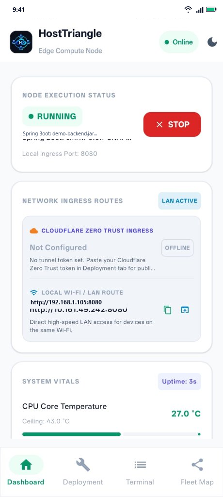
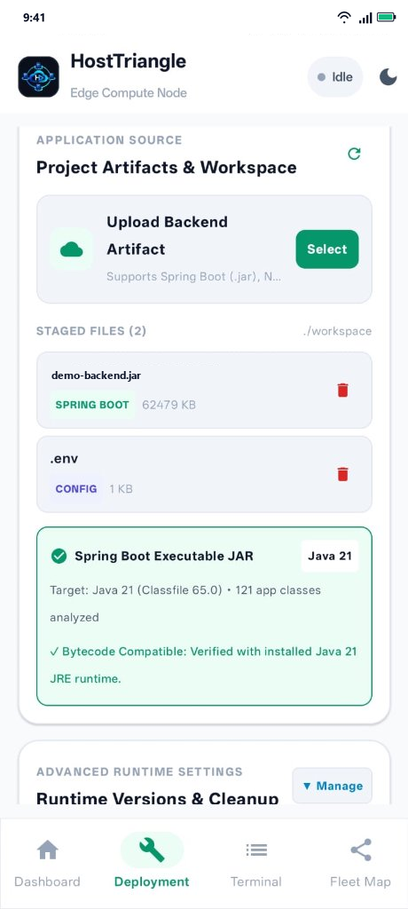
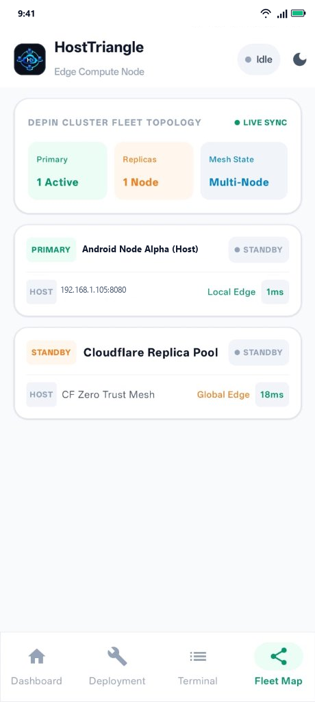
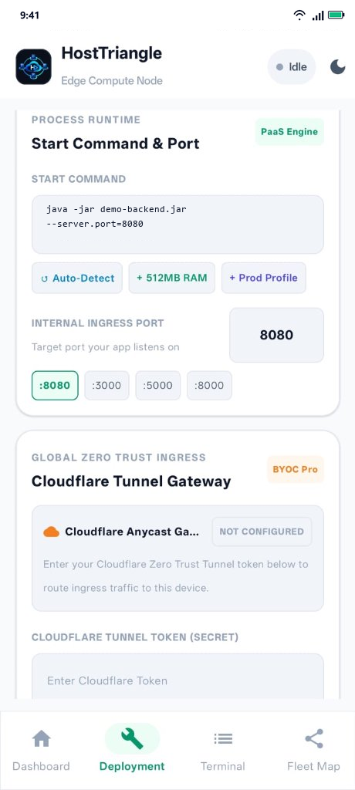
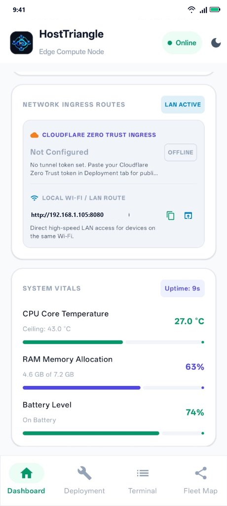
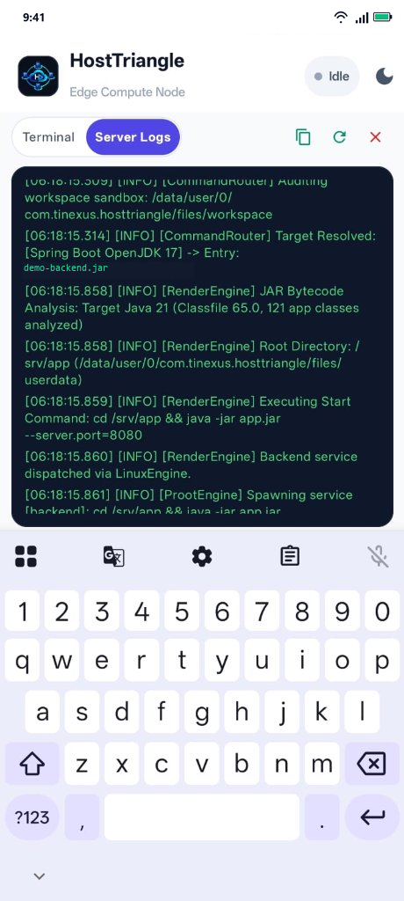

<p align="center">
  
</p>

<p align="center">
  
</p>

<p align="center">
  <strong>Distributed Edge Compute Nodes for Android</strong><br />
  <a href="https://hosttriangle.tinexus.in"><strong>hosttriangle.tinexus.in</strong></a>
</p>

<p align="center">
  HostTriangle turns Android smartphones and tablets into high-performance, resilient, and distributed edge computing nodes. By leveraging containerized rootless Linux environments, modern JNI pseudo-terminal (PTY) emulation, and encrypted reverse tunnels, HostTriangle enables server workloads, microservices, and cluster management directly on edge hardware.
</p>

---

## Why I Built HostTriangle

Like most developers and students, deploying my frontend was completely free and instant—but hosting the backend was a nightmare. Every free backend hosting tier came with painful **30–50 second cold starts**, and keeping a PC or laptop running 24/7 wasn't practical.

Then it hit me: **my Android phone—and the phones of my family and friends—are already powered on and connected to the internet 24/7.** They are literal Linux-capable machines sitting in our pockets.

So I built **HostTriangle** to turn spare and everyday Android devices into an always-on, zero-cold-start backend cluster:
* **Stateless by Design:** The database lives safely on a free cloud hobby tier (preventing local data exposure across devices), while your stateless backend—whether Spring Boot (`.jar`), Node.js, or Python—runs seamlessly across multiple phones.
* **Self-Healing & Zero Downtime:** With built-in auto-restart and Cloudflare Tunnel load balancing, if one friend's phone goes offline or reboots, Cloudflare seamlessly routes traffic to the other active phones.

---

## The Honest Reality: What HostTriangle Actually Does

Let's be completely real: **I didn't invent some revolutionary, alien technology.** 

Technically, anyone with enough patience could already stitch this together manually:
1. Install Termux or an Android PTY terminal.
2. Manually install and configure runtimes (Node.js, Python, or OpenJDK).
3. Fight with Android OS battery managers to keep background processes alive.
4. Download the `cloudflared` binary, write YAML config files, and paste tunnel tokens into a shell.
5. Manually manage port bindings, dependencies, and restart commands every time the phone reboots.

**Anyone *could* do it—but almost nobody *wants* to do it.** It is tedious, easy to break, and a headache for a normal college student or developer who just wants their project backend online.

All **HostTriangle** really does is take all those fragmented, painful steps and connect them together into a clean, unified Android app:

* **No Terminal Headaches:** No memorizing Linux commands or manually setting up environment paths.
* **Multi-Stack Support:** Run your **Java / Spring Boot** (`.jar`), **Node.js** (`node server.js`), or **Python** (`uvicorn`/`python app.py`) backends effortlessly.
* **Local Code & Secrets Privacy:** Your source code, binaries, and `.env` files are stored in the app's private storage on your phone and are never uploaded to any HostTriangle server (HostTriangle has no server). Public requests route through Cloudflare's network, and external databases live on their respective providers.
* **Paste Token & Tap Launch:** Paste your Cloudflare Tunnel token, tap Start, and your backend is live with an always-on public HTTPS link.

---

### Backends & Runtimes

HostTriangle bundles a rootless Debian environment (`PRoot`) with on-demand runtimes:
* **Java & JVM (Tested):** Spring Boot (`.jar`), standalone JARs (Eclipse Temurin OpenJDK 8, 11, 17, 21 LTS). Built-in bytecode analyzer inspects the JAR's major version and checks runtime compatibility.
* **Node.js, Python, & ARM64 Binaries (Experimental):** Auto-detected and launched from your workspace. Test suite across common frameworks is ongoing.

---

## Intended Use & Scope

HostTriangle is intended for students, hobbyists, indie developers, and small personal or college projects. It is not intended for mission-critical or enterprise systems.

* **Stateless Compute:** Keep your backends lightweight and stateless (always offload databases and persistent storage to free cloud hobby tiers such as Supabase, Neon, or MongoDB Atlas).
* **Zero Telemetry:** HostTriangle does not collect, track, or transmit any analytics, crash reports, or user telemetry to any developer or third-party server. All telemetry metrics (CPU temperature, battery status) stay 100% local on your device.

---

## Disclaimer & Limitation of Liability

By downloading, compiling, installing, or using **HostTriangle**, you explicitly acknowledge and agree to the following terms:

1. **User Responsibility & Compliance:** You are solely responsible for the services you host, the commands you execute, and for complying with the terms of Cloudflare, your network provider, and all applicable local, national, and international laws.
2. **No Warranty ("AS IS"):** In accordance with Sections 15 and 16 of the **GNU General Public License v3.0 (GPL-3.0-only)**, this software is provided *"AS IS"*, without warranty of any kind, whether express, implied, or statutory, including without limitation the warranties of merchantability, fitness for a particular purpose, or non-infringement.
3. **Hardware Wear & Battery Guidance:** Running continuous background compute workloads on a mobile device can cause battery wear or elevated operating temperatures. The author and contributors are not responsible for physical device damage, hardware wear, thermal shutdowns, or data loss. Users are advised to run nodes with battery protection enabled.
4. **Third-Party Components & Trademarks:** HostTriangle is an independent open-source project and is not affiliated with, endorsed, sponsored, or certified by Cloudflare, Inc., the Termux project, Google LLC, or Debian. Terminal rendering utilizes open-source libraries from the Termux project. See [THIRD_PARTY_NOTICES.md](THIRD_PARTY_NOTICES.md) for full component notices, copyright attributions, and source code offers.

---

## Screenshots & Visual Walkthrough

<p align="center">
  
  
  
</p>

<p align="center">
  
  
  
</p>

| Screenshot | Feature Highlight |
| :--- | :--- |
| **01 Dashboard** | One-tap server control, active execution state, live CPU/RAM metrics, and high-speed ingress routes. |
| **02 Deployment (Artifacts)** | Built-in JVM bytecode analyzer scanning Java classfiles (Java 17/21 compatibility) and managing `.jar` workspaces. |
| **03 Fleet Map** | Multi-node edge cluster discovery, real-time node health monitoring, and Cloudflare replica failover pool. |
| **04 Deployment (Runtime)** | Start command generator, ingress port switcher (8080/3000/5000), and Cloudflare Zero Trust Tunnel setup. |
| **05 Terminal & Logs** | Native 16 KB PTY interactive shell (`PRoot` Linux sandbox) streaming live Spring Boot startup logs. |

---

## Key Architecture & Features

* **Clean-Room 16 KB Page-Size Native PTY Engine:**
  - Custom POSIX pseudo-terminal engine implemented in [`app/src/main/cpp/hosttriangle_pty.c`](app/src/main/cpp/hosttriangle_pty.c) (`libtermux.so`).
  - Fully compliant with Android 15+ 16 KB memory page-size requirements (`-Wl,-z,max-page-size=16384`).
  - Written from scratch with complete clean-room isolation, proper signal unblocking (`sigprocmask`), directory-based file descriptor closing (`/proc/self/fd`), UTF-8 terminal defaults (`IUTF8`), and robust environment fallbacks.
* **Rootless Virtualization with PRoot:**
  - Runs full Linux distributions (Ubuntu, Debian, Alpine) on Android without root permissions.
  - Bundled with aarch64 native engines (`libproot.so`, `libproot-loader.so`, `libtalloc.so`, `libandroid-shmem.so`).
* **Zero-Config Ingress with Cloudflare Tunnel:**
  - Encrypted multi-protocol reverse tunneling (`libcloudflared.so`) exposing local edge services safely to public DNS.
* **Distributed Cluster Fleet Management:**
  - Local peer discovery and cluster sync across multiple Android hardware nodes.
* **Modern Jetpack Compose UI:**
  - Real-time terminal interface, performance metrics, live logs, and intuitive setup wizard.

---

## Source Tree Overview

```
.
├── app/
│   ├── src/main/cpp/
│   │   ├── hosttriangle_pty.c       # First-party 16 KB native PTY implementation
│   │   └── CMakeLists.txt           # Native build configuration with 16 KB alignment
│   ├── src/main/java/               # HostTriangle Android source code
│   └── src/main/jniLibs/arm64-v8a/  # Bundled native runtime binaries
├── docs/
│   ├── assets/                      # Brand assets (HostTriangle icon and wordmark)
│   └── screenshots/                 # Sanitized application screenshots for documentation
├── third_party_src/                 # Complete corresponding source recipes & downloaders
│   ├── proot/                       # PRoot v5.1.107-102 build recipe & documentation
│   ├── talloc/                      # Samba talloc 2.5.0 build recipe & documentation
│   ├── libandroid-shmem/            # android-shmem v0.7 build recipe
│   ├── download_sources.sh          # Bash script to download all upstream source archives
│   ├── download_sources.bat         # Windows batch script to download source archives
│   └── archives/                    # Downloaded machine-readable upstream sources
├── CONTRIBUTING.md                  # Contribution guidelines & AI usage policy
├── LICENSE                          # GNU General Public License v3.0 (GPL-3.0-only)
├── SECURITY.md                      # Security policy & vulnerability reporting
└── THIRD_PARTY_NOTICES.md           # Third-party notices & written offer for GPL source code
```

---

## Contributing

Contributions, bug fixes, and runtime additions are welcome! Please review [CONTRIBUTING.md](CONTRIBUTING.md) for our core design principles, 16 KB page-size compliance requirements, local sandbox privacy rules, and AI/LLM contribution policy before submitting a pull request.

---

## License & Open Source

HostTriangle's own code is licensed under the GNU General Public License v3.0 only ([GPL-3.0-only](LICENSE)).

* **Primary License:** GNU General Public License v3.0 only ([GPL-3.0-only](LICENSE))
* **Copyright:** Copyright (C) 2026 Abhishek Gour (Tinexus)

### Third-Party Software & Components
HostTriangle bundles several third-party open-source components (including PRoot, talloc, Termux terminal libraries, and cloudflared), which keep their respective open-source licenses (GPLv2, LGPLv3, Apache 2.0). For complete attribution, licenses, and source code offers, please consult [THIRD_PARTY_NOTICES.md](THIRD_PARTY_NOTICES.md) and [third_party_src/](third_party_src/).

---

## Project Website & Links

* **Official Website:** [https://hosttriangle.tinexus.in](https://hosttriangle.tinexus.in)
* **Security Policy:** [SECURITY.md](SECURITY.md)
* **Contribution Guide:** [CONTRIBUTING.md](CONTRIBUTING.md)
* **License:** [GNU General Public License v3.0 (GPL-3.0-only)](LICENSE)
